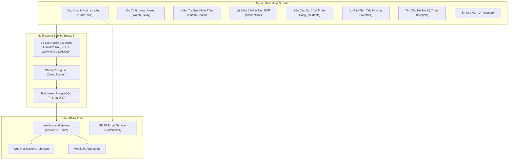

# Danh Mục Tổng Hợp Toàn Bộ Thông Báo Trong Hệ Thống SSFM
*(Smart Shrimp Farm Management System - Quy trình 5T Care)*

Tài liệu này tổng hợp toàn bộ các loại thông báo, cảnh báo tự động, email thông báo và sự kiện thời gian thực (Real-time WebSocket) được thiết kế và triển khai trong hệ thống **SSFM**.

---

## 1. Kiến Trúc & Các Kênh Phân Phối Thông Báo

Hệ thống SSFM hỗ trợ 4 kênh truyền thông báo:
1. **WebSocket Realtime (`NotificationsGateway`):** Đẩy thông báo tức thời tới giao diện Web và Mobile app của người dùng đang đăng nhập thông qua room riêng biệt `user_{userId}`.
2. **In-App Notification Center (`notifications` table):** Lưu trữ lịch sử thông báo, cho phép đọc, lọc theo mức độ nghiêm trọng, đánh dấu đã đọc hoặc xóa.
3. **Email Notifications (`EmailService` / Nodemailer):** Gửi các thông báo quan trọng ra bên ngoài (Mời tham gia trang trại, mã OTP đặt lại mật khẩu).
4. **Toast Notifications tương tác nhanh:** Khi có thông báo mới, hệ thống hiển thị banner nổi kèm nút điều hướng nhanh tới đúng ao nuôi hoặc màn hình xử lý tương ứng.

---

## 2. Ma Trận Phân Quyền Người Nhận (Recipient Matrix)

Hệ thống phân cấp 3 mức độ cảnh báo chính (`NotificationLevel`):
* `INFO` (Xanh / Xám): Thông tin vận hành bình thường, xác nhận thao tác thành công.
* `WARNING` (Vàng / Cam): Chỉ số có dấu hiệu bất thường, cần chú ý theo dõi hoặc chuẩn bị vật tư.
* `DANGER` (Đỏ): Tình trạng nguy hiểm, vượt ngưỡng sinh tồn của tôm, yêu cầu can thiệp khẩn cấp.

| Nhóm Thông Báo | Loại Sự Kiện | ADMIN | FARM_MANAGER | TECHNICIAN | FARMER |
| :--- | :--- | :---: | :---: | :---: | :---: |
| **Hệ Thống & Tài Khoản** | Chào mừng đăng ký mới | - | ✔ (cá nhân) | ✔ (cá nhân) | ✔ (cá nhân) |
| | Lời mời gia nhập trang trại | - | - | ✔ | ✔ |
| | Thành viên mới đã tham gia | - | ✔ (chủ farm) | - | - |
| | Xác nhận đã tham gia trang trại | - | - | ✔ | ✔ |
| | Tạo Farm / Ao / Vụ nuôi thành công | - | ✔ (người tạo) | - | - |
| | Mã OTP đặt lại mật khẩu (Email) | ✔ | ✔ | ✔ | ✔ |
| | Ticket hỗ trợ kỹ thuật (Mới / Cập nhật) | ✔ (tất cả) | ✔ (người yêu cầu) | ✔ (người yêu cầu) | ✔ (người yêu cầu) |
| **Môi Trường Nước** | Đo nước định kỳ (Bình thường - `INFO`) | - | ✔ | ✔ | ✔ |
| | Môi trường chớm biến động (`WARNING`) | - | ✔ | ✔ | ✔ |
| | Môi trường nguy hiểm (`DANGER`) | - | ✔ | ✔ | ✔ |
| **Sức Khỏe Tôm** | Kiểm tra sức khỏe thông thường (`INFO`/`WARN`) | - | ✔ | ✔ | ✔ |
| | Báo động đỏ 3 lần liên tiếp (`DANGER`) | - | ✔ | ✔ | ✔ |
| **Tăng Trưởng & FCR** | Mẫu đo 5 mẻ & FCR ổn định (`INFO`) | - | ✔ | ✔ | ✔ |
| | FCR tăng / Tăng trọng chậm (`WARNING`) | - | ✔ | ✔ | ✔ |
| | FCR > 1.5 / Sụt cân ADG âm / Tỷ lệ sống < 70% (`DANGER`) | - | ✔ | ✔ | ✔ |
| **Sự Cố Trang Trại** | Báo cáo sự cố mới phát sinh | - | ✔ (tất cả Manager) | - | - |
| | Phân công kỹ thuật viên xử lý | - | - | ✔ (KTV được giao) | - |
| **Thiên Tai & Thời Tiết** | Cảnh báo Bão / Lốc xoáy (`DANGER`) | - | ✔ | ✔ | ✔ |
| | Cảnh báo Mưa lớn / Ngập lụt (`DANGER`) | - | ✔ | ✔ | ✔ |
| | Cảnh báo Nắng nóng cực đoan (`WARNING`) | - | ✔ | ✔ | ✔ |
| **Kho & Vật Tư** | Cảnh báo tồn kho dưới ngưỡng an toàn | - | ✔ | ✔ | ✔ |

---

## 3. Danh Mục Chi Tiết Từng Loại Thông Báo

### 3.1. Nhóm 1: Hệ Thống, Tài Khoản & Quản Trị Trang Trại

#### 1. Chào mừng tài khoản mới (Welcome Notification)
* **Kênh:** In-App WebSocket + DB.
* **Mức độ:** `INFO`.
* **Tiêu đề:** `Chào mừng đến với SSFM`
* **Nội dung:** `Chào mừng bạn đã đến với Smart Shrimp Farm Management System.`
* **Kích hoạt:** Khi người dùng hoàn tất đăng ký tài khoản mới qua form đăng ký hoặc qua Google OAuth (trường hợp đăng ký tự do, không đi qua link mời).

#### 2. Lời mời tham gia trang trại - Nhánh người dùng đã có tài khoản
* **Kênh:** Email + In-App WebSocket.
* **Mức độ:** `INFO`.
* **Tiêu đề In-App:** `Lời mời tham gia trang trại {farmName}`
* **Nội dung In-App:** `Quản lý {managerName} đã mời bạn tham gia trang trại "{farmName}" với vai trò {Kỹ Thuật Viên / Nông Dân}. Vui lòng xác nhận qua email hoặc đăng nhập để tham gia.`
* **Email:** 
  * Tiêu đề: `🦐 [SSFM] Bạn đã được thêm vào trang trại "{farmName}"`
  * Nội dung email: Nút bấm xác nhận đăng nhập kèm quyền hạn được cấp.

#### 3. Lời mời tham gia trang trại - Nhánh người dùng chưa có tài khoản
* **Kênh:** Email.
* **Email:**
  * Tiêu đề: `🦐 [SSFM] Lời mời tham gia trang trại "{farmName}"`
  * Nội dung: Chứa link đăng ký kèm JWT token có hạn trong **7 ngày**. Sau khi đăng ký xong, hệ thống tự động gán tài khoản vào trang trại và cấp quyền tương ứng.

#### 4. Thành viên mới đã chấp nhận lời mời (Staff Joined Notification)
* **Người nhận:** Farm Manager / Farm Owner.
* **Mức độ:** `INFO`.
* **Tiêu đề:** `{Kỹ thuật viên / Nông dân} mới đã tham gia trang trại`
* **Nội dung:** `{Kỹ Thuật Viên / Nông Dân} {staffName} ({staffEmail}) đã chấp nhận lời mời và chính thức tham gia vào trang trại "{farmName}" của bạn.`

#### 5. Xác nhận thành viên gia nhập trang trại thành công (Farm Join Notification)
* **Người nhận:** Kỹ thuật viên hoặc Nông dân vừa tham gia.
* **Mức độ:** `INFO`.
* **Tiêu đề:** `Gia nhập trang trại {farmName}`
* **Nội dung:** 
  * KTV: `Chào mừng bạn gia nhập trang trại "{farmName}" với vai trò Kỹ Thuật Viên (Technician). Chúc bạn làm việc hiệu quả!`
  * Farmer: `Chào mừng bạn gia nhập trang trại "{farmName}" với vai trò Nông Dân (Farmer). Chúc bạn một vụ mùa bội thu!`

#### 6. Tạo Trang Trại Thành Công (Farm Created)
* **Người nhận:** Quản lý trang trại tạo farm.
* **Mức độ:** `INFO`.
* **Tiêu đề:** `Tạo trang trại thành công`
* **Nội dung:** `Trang trại "{farmName}" đã được tạo thành công trên hệ thống.`

#### 7. Tạo Ao Nuôi Thành Công (Pond Created)
* **Người nhận:** Quản lý trang trại tạo ao.
* **Mức độ:** `INFO`.
* **Tiêu đề:** `Tạo ao nuôi thành công`
* **Nội dung:** `Ao nuôi "{pondName}" thuộc trang trại "{farmName}" đã được tạo thành công.`

#### 8. Tạo Vụ Nuôi Thành Công (Crop Created)
* **Người nhận:** Quản lý trang trại bắt đầu vụ nuôi.
* **Mức độ:** `INFO`.
* **Tiêu đề:** `Tạo vụ nuôi thành công`
* **Nội dung:** `Vụ nuôi mới tại ao "{pondName}" ({farmName}) đã được tạo thành công.`

#### 9. Mã OTP Đặt Lại Mật Khẩu (Password Reset OTP)
* **Kênh:** Email.
* **Tiêu đề:** `Mã OTP đặt lại mật khẩu SSFM`
* **Nội dung:** Mã xác thực 6 số, thời hạn hiệu lực **5 phút**, chống spam giới hạn gửi lại.

#### 10. Yêu Cầu Hỗ Trợ Kỹ Thuật (Support Tickets)
* **Khi tạo ticket:** Gửi Admin với mức độ `INFO` / `WARNING` / `DANGER` (tùy theo Priority: NORMAL, HIGH, URGENT).
  * Tiêu đề: `Yêu cầu hỗ trợ mới`
  * Nội dung: `{Tên workspace / Hệ thống SSFM}: {Tiêu đề yêu cầu}`
* **Khi cập nhật trạng thái:** Gửi lại cho người yêu cầu.
  * Tiêu đề: `Cập nhật yêu cầu hỗ trợ`
  * Nội dung: `Yêu cầu "{subject}" {mới được tạo / đã được tiếp nhận / đã được xử lý xong / đã được đóng}.`

---

### 3.2. Nhóm 2: Môi Trường Nước & Cảnh Báo Chỉ Số Ao Nuôi (FE-38)

Mỗi khi Kỹ thuật viên nhập bản ghi đo chất lượng nước định kỳ (`POST /api/water-quality`), hệ thống tự động phân tích và phát thông báo Real-time cho Quản lý và Nông dân trong trang trại:

#### Điều kiện phân loại mức độ:
* **Mức DANGER (Nguy hiểm):**
  * Oxy hòa tan đáy $DO \le 3.0$ mg/L (tôm có nguy cơ nổi đầu ngạt thở).
  * $pH < 7.5$ hoặc $pH > 8.5$ (gây sốc môi trường hoặc tăng độc tính $NH_3$).
  * Khí độc $NH_3 > 0.3$ mg/L (nguy cơ nhiễm độc cấp tính).
  * Đánh giá tổng thể `overallStatus === 'Danger'`.
* **Mức WARNING (Cần chú ý):**
  * $3.0 < DO \le 4.0$ mg/L.
  * Độ kiềm $< 100$ hoặc $> 160$ mg/L.
  * Đánh giá tổng thể `overallStatus === 'Warning'`.
* **Mức INFO (Ổn định):** Các chỉ số nằm trong ngưỡng tiêu chuẩn.

#### Cấu trúc thông báo:
* **Tiêu đề:**
  * Nếu DANGER: `⚠️ [NGUY HIỂM] Môi trường nước {pondName}`
  * Nếu WARNING: `⚡ [CHÚ Ý] Môi trường nước {pondName}`
  * Nếu INFO: `Cập nhật môi trường nước: {pondName}`
* **Nội dung:**
  `KTV {technicianName} vừa đo thông số ao "{pondName}": DO {dissolvedOxygen} mg/L, pH {ph}, Temp {temperature}°C, Mặn {salinity}‰ ({statusText}) [Cảnh báo: {danh_sách_chỉ_số_vượt_ngưỡng}]. Nhấn để xem chi tiết ao.`

---

### 3.3. Nhóm 3: Sức Khỏe Tôm & Báo Động Đỏ Dịch Bệnh (FE-23)

Mỗi khi Kỹ thuật viên thực hiện kiểm tra lâm sàng tôm tại ao:

#### 1. Thông báo cập nhật tình trạng sức khỏe định kỳ:
* **Kích hoạt:** KTV ghi nhận trạng thái (`NORMAL`, `LETHARGIC` - lờ đờ, `EDGE_GATHERING` - tấp mé, `LOSS_OF_APPETITE` - bỏ ăn), mức độ (`MILD`, `MODERATE`, `SEVERE`) và tỷ lệ phần trăm tôm bị ảnh hưởng.
* **Mức độ:**
  * `DANGER`: Mức độ SEVERE hoặc tôm tấp mé/lờ đờ diện rộng.
  * `WARNING`: Mức độ MODERATE hoặc MILD có triệu chứng.
  * `INFO`: Trạng thái bình thường.
* **Tiêu đề:** 
  * Nếu DANGER: `⚠️ [CẢNH BÁO BỆNH] Ao {pondName}: Tôm {statusLabel} ({severityLabel})`
  * Nếu bình thường: `Cập nhật sức khỏe tôm: {pondName}`
* **Nội dung:** `KTV {technicianName} vừa kiểm tra sức khỏe tôm ao "{pondName}": Tình trạng: {statusLabel} (Mức độ: {severityLabel}), Tỷ lệ ảnh hưởng: {affectedPercentage}%. Ghi chú: "{note}". Nhấn để xem chi tiết ao.`

#### 2. Cảnh báo khẩn cấp: BÁO ĐỘNG ĐỎ 3 LẦN LIÊN TIẾP (`checkConsecutiveCriticalRecords`)
* **Kích hoạt:** Hệ thống quét lịch sử 3 lần ghi nhận gần nhất của ao; nếu **cả 3 lần liên tiếp đều ở mức bất thường nặng** (tấp mé hoặc bỏ ăn):
* **Mức độ:** `DANGER`.
* **Tiêu đề:** `🚨 [BÁO ĐỘNG ĐỎ] Ao "{pondName}" bất thường 3 lần liên tiếp!`
* **Nội dung:** `Ao "{pondName}" ghi nhận liên tục 3 lần tình trạng tôm bất thường (tấp mé / bỏ ăn). Nguy cơ bùng phát dịch bệnh, cần cách ly hoặc can thiệp khẩn cấp! Nhấn để kiểm tra ngay.`

---

### 3.4. Nhóm 4: Tăng Trưởng, Lấy Mẫu 5 Mẻ & Chỉ Số FCR (5T Care - FE-32, FE-35)

Vào Ngày 5 của chu kỳ 5T Care, khi KTV ghi nhận kết quả chài 5 mẻ:

#### Thuật toán đánh giá mức độ tăng trưởng & FCR:
1. **Mức DANGER:**
   * Tôm sụt cân: $ADG < 0$ g/ngày.
   * Tỷ lệ sống sụt giảm nghiêm trọng: $Survival\ Rate < 70\%$.
   * Hệ số thức ăn quá cao: $FCR > 1.5$ (so với mục tiêu $1.1 - 1.25$).
2. **Mức WARNING:**
   * Tăng trưởng chậm: $ADG < 0.1$ g/ngày khi ngày nuôi $DOC > 30$.
   * Tỷ lệ sống dưới mức tối ưu: $70\% \le Survival\ Rate < 85\%$.
   * Hệ số $FCR$ tăng nhẹ: $1.35 < FCR \le 1.5$.
3. **Mức INFO:**
   * Tăng trưởng ổn định, $FCR \le 1.35$, tỷ lệ sống $\ge 85\%$.

#### Cấu trúc thông báo:
* **Tiêu đề:**
  `Tăng trưởng & FCR {pondName} (DOC {doc}): Size {sizeStr} con/kg - FCR {currentFCR}`
* **Nội dung:**
  `{technicianName} vừa cập nhật mẫu đo tại ao {pondName} ({farmName}). Trọng lượng: {abwStr}g/con, ADG: {adgStr}, Sinh khối: {biomassStr}, FCR: {fcrStr}. Đánh giá: {statusComment}.`

---

### 3.5. Nhóm 5: Quản Lý Sự Cố Trang Trại (Incident Management - FE-42, FE-43)

#### 1. Báo Cáo Sự Cố Mới (Incident Reported)
* **Kích hoạt:** Nông dân hoặc Kỹ thuật viên phát hiện sự cố (hỏng quạt nước, cúp điện, tôm rớt đáy, váng bọt...) và gửi báo cáo.
* **Người nhận:** Tất cả Quản lý (Farm Manager) và Chủ trang trại (Owner).
* **Mức độ:** `WARNING` (nếu mức độ nghiêm trọng là `CRITICAL` / `HIGH` / `Khẩn cấp` / `Cao`) hoặc `INFO`.
* **Tiêu đề:** `[Báo cáo sự cố] {incidentTitle}`
* **Nội dung:** `{reporterName} ({reporterRole}) vừa báo cáo sự cố mới tại {pondName} ({farmName}) • Phân loại: {category} • Mức độ: {severity}. Vui lòng kiểm tra và phân công xử lý.`

#### 2. Phân Công Kỹ Thuật Viên Xử Lý Sự Cố (Incident Assigned)
* **Kích hoạt:** Quản lý chọn kỹ thuật viên phụ trách giải quyết sự cố.
* **Người nhận:** Kỹ thuật viên được chỉ định (`assigneeId`).
* **Mức độ:** `WARNING`.
* **Tiêu đề:** `[Phân công sự cố] {incidentTitle}`
* **Nội dung:** `Quản lý {managerName} đã phân công bạn xử lý sự cố "{incidentTitle}" tại {pondName}. Vui lòng tiếp nhận và cập nhật tiến độ xử lý.`

---

### 3.6. Nhóm 6: Cảnh Báo Thiên Tai & Thời Tiết Cực Đoan (FE-40)

Định kỳ hoặc khi người dùng mở ứng dụng, hệ thống quét dữ liệu dự báo 14 ngày từ API khí tượng (Open-Meteo) ứng với tọa độ vùng nuôi:

#### 1. Cảnh báo Bão / Lốc xoáy:
* **Điều kiện:** Dự báo gió giật $wind\_gusts > 60$ km/h.
* **Mức độ:** `DANGER`.
* **Tiêu đề:** `Cảnh báo Bão / Lốc xoáy`
* **Nội dung:** `Dự báo có bão/lốc xoáy (gió giật {windGusts} km/h) bắt đầu từ ngày {dd/MM} tại {locationName}. Hãy chủ động gia cố bờ ao.`

#### 2. Cảnh báo Mưa Lớn / Ngập lụt:
* **Điều kiện:** Dự báo tổng lượng mưa trong ngày $precipitation > 50$ mm.
* **Mức độ:** `DANGER`.
* **Tiêu đề:** `Cảnh báo Mưa Lớn / Ngập lụt`
* **Nội dung:** `Dự báo mưa lớn kéo dài (lượng mưa {precip}mm) bắt đầu từ ngày {dd/MM} tại {locationName}. Chuẩn bị rải vôi để ổn định pH.`

#### 3. Cảnh báo Nắng Nóng Cực Đoan:
* **Điều kiện:** Dự báo nhiệt độ cao nhất trong ngày $temperature\_max > 37^\circ\text{C}$.
* **Mức độ:** `WARNING`.
* **Tiêu đề:** `Cảnh báo Nắng nóng cực đoan`
* **Nội dung:** `Dự báo nắng nóng gay gắt ({maxTemp}°C) bắt đầu từ ngày {dd/MM} tại {locationName}. Tăng thời gian chạy quạt nước.`

---

### 3.7. Nhóm 7: Kho & Vật Tư Nuôi Tôm (FE-29)

* **Kích hoạt:** Sau mỗi lần trừ kho thức ăn (khi Farmer chốt nhật ký cho ăn) hoặc xuất kho thuốc/hóa chất xử lý sự cố.
* **Điều kiện:** Số lượng tồn kho thực tế giảm xuống mức $\le$ ngưỡng tồn tối thiểu (`quantity <= minThreshold`).
* **Hiển thị:** Huy hiệu đỏ trên Dashboard và danh sách vật tư cảnh báo trong phân hệ Kho, hiển thị số lượng mặt hàng cần đặt bổ sung ngay (`lowStockCount`).

---

## 4. Các API Quản Trị & Thao Tác Thông Báo

| Method | Endpoint | Mô Tả |
| :--- | :--- | :--- |
| `GET` | `/api/notifications` | Lấy danh sách 50 thông báo gần nhất của người dùng hiện tại (kèm tên ao, tên farm). |
| `GET` | `/api/notifications/unread-count` | Lấy số lượng thông báo chưa đọc để hiển thị Badge trên chuông thông báo. |
| `PUT` | `/api/notifications/:id/read` | Đánh dấu 1 thông báo cụ thể là đã đọc. |
| `PUT` | `/api/notifications/read-all` | Đánh dấu tất cả thông báo của người dùng là đã đọc. |
| `DELETE` | `/api/notifications/:id` | Xóa 1 thông báo khỏi danh sách. |
| `DELETE` | `/api/notifications` | Xóa toàn bộ lịch sử thông báo của người dùng. |
